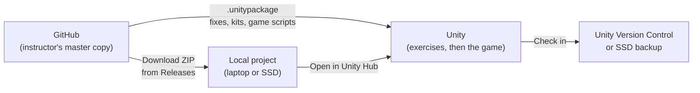

# Teaching Philosophy & Project Pipeline

> [!abstract] Purpose
> This note records how the course is meant to work before any scripts or genre templates are written: what students do and when, where the project files come from, who owns which folders, and how fixes reach students. Scripts, exercises and tutorials should all follow it.
>
> Where this note differs from `GitHub Repository Setup`, this note is the current plan.

---

## 1. Problems this design solves

These came up in the current semester:

| Problem | Cause | Fix in this design |
|---|---|---|
| Script errors when students combined scripts | Two separate script sets (`helperScripts` and `gameScripts`) that were never built to work together | **One script set.** The exercises use the same core scripts the games are built from. Add-on scripts depend on the core and never replace it. |
| Confusion about what to work on | Exercises and the student's own game ran at the same time | **Exercises first.** No student builds their own game in Unity until the exercises are finished (week 8). |
| "Why do this exercise? My game doesn't have that mechanic." | Exercises taught genre-specific mechanics | **Exercises cover only systems every game uses.** Genre-specific mechanics live in the genre kits. |
| Students starting to build without a clear design | Design documents overlapped with production | **Paper before Unity.** Pitch, one-sheet, screen layout and ten-pager are all finished before game production starts. |

---

## 2. Principles

1. **One script set.** Every exercise uses the scripts students will later build their game with. Nothing learned in an exercise is thrown away.
2. **Exercises before games.** Weeks 1–7 of Unity time go to the exercises, in one shared sandbox game. Game production starts in week 8.
3. **Paper before Unity.** Students pitch in week 3 so they have a goal, then design on paper in weeks 3–7. The design documents are complete before they build.
4. **Layout before UI.** Students draw their screen layouts before the UI lecture, so they can see how UI Toolkit turns their own drawing into a working screen.
5. **Exercises teach what every game needs.** Input, events, scenes, health and score, UI, winning and losing. Genre mechanics are delivered in kits after the pitch. Where an exercise has to choose a style of play, it offers a choice: Exercise 05 comes in a real-time and a turn-based version.
6. **The core is frozen during the semester.** Core scripts change only to fix errors. New features and renames wait for the next semester's version.
7. **Add, never replace.** Genre kits and game-specific scripts go in their own folders and depend on the core. Importing one can't break the exercises or another student's setup.
8. **Clear ownership.** The instructor owns `Assets/_Course/`. The student owns everything else. Updates only touch the instructor's folder.
9. **Games stay within the supported genres.** Students pitch games that fit the prepared genre kits, with only limited custom scripts for each game.
10. **Few tools.** Students need Unity and a way to back up their work. They don't need Git or a GitHub account, and GitHub isn't used in the lab. Students who want to may use their own GitHub account and repository on their own computers.

---

## 3. The pipeline

Files flow in one direction: from the instructor's GitHub repository to the student. Students never send anything back to GitHub.

### Stage 1 — GitHub: the instructor's master copy

- **`IntroToGameDesign-template`** is the Unity project students start from. It contains the core scripts and the exercise scenes.
- **`IntroToGameDesign-course`** holds the schedule, design-document templates, tutorials and planning notes.
- Both are public. Anyone can download; only collaborators the instructor adds can change them. **Students have no write access and need no GitHub account.**
- The instructor (with Claude) writes and tests changes here. Git is the instructor's tool here; students only download.
- Each tested version is published as a **Release** with a version number:

| Published on the Release page | For whom |
|---|---|
| The project as a ZIP | Anyone starting fresh. It always includes every fix so far. |
| `Update` `.unitypackage` | Students who already started. Each update is cumulative, so a student only ever needs the latest one. |
| Genre kit `.unitypackage` files | Students whose pitched game matches that genre (from week 3 on). |
| Game-specific `.unitypackage` files | One student's game, written after the pitches. |

### Stage 2 — Local project: the student's working copy

1. Download the project ZIP from the Releases page.
2. **Unzip it fully** to a laptop folder or an SSD. (Windows can browse inside a ZIP without unzipping it; Unity can't open a project from there.)
3. Rename the folder to the student's own project name.
4. In Unity Hub: **Add → Add project from disk**, and select the folder.

The first time the project opens, Unity builds its `Library` folder, which takes several minutes.

- **Laptop students** keep the project on the laptop.
- **Lab students** keep the project on their own SSD and open it directly from the SSD on any lab computer. An SSD used on both Windows and Mac should be formatted as exFAT.

### Stage 3 — Unity: who owns which folder

| Folder | Owner | Contents |
|---|---|---|
| `Assets/_Course/Core/` | Instructor | Core scripts. Fixed only for errors during the semester. |
| `Assets/_Course/TwoD/` | Instructor | Scripts for 2D games, such as the player controllers. |
| `Assets/_Course/Exercises/` | Instructor | Exercise scenes and prefabs. |
| `Assets/_Course/Kits/<Genre>/` | Instructor | Genre kits, imported after the pitch. |
| `Assets/_Course/Games/<GameName>/` | Instructor | Scripts written for one student's game. |
| `Assets/_Game/` | Student | The student's own scenes, art, audio and scripts. |
| `Assets/Scenes/Exercises/` | Student | The student's **Save As** copies of the exercise scenes. |

Rules that keep updates safe:

- **Students never edit, move or rename anything inside `_Course`.** To change a course script, copy it into `_Game` and edit the copy.
- **Updates only touch `_Course`.** Importing a `.unitypackage` overwrites files there and leaves the student's folders alone.
- **Students work in copies of exercise scenes.** Because of Save As, an updated exercise scene never overwrites a student's work.
- **No core file is renamed or deleted mid-semester.** A `.unitypackage` can add and overwrite files but can't remove them. A renamed script would leave its old copy behind and cause errors.
- **Extra Unity packages are the student's choice.** Students may install what their game needs through the Package Manager.
- **A version file** (`Assets/_Course/VERSION.txt`) shows which update a student has, so problems can be checked quickly in lab.

To install an update: with the project open, double-click the `.unitypackage` (or **Assets → Import Package → Custom Package**), then click **Import**.

### Stage 4 — Unity Version Control or SSD: keeping the work safe

Students choose one. Whichever they choose, the work is theirs.

**Option A — Unity Version Control (recommended)**

- Set up once, in Unity Hub: open the project's menu (⋯) → **Use Unity Version Control** → **Connect to Version Control**. It needs only the student's Unity ID.
- At the end of every work session: **Window → Unity Version Control**, write a short comment, and **check in**.
- On another computer: Unity Hub → **Add → Add from repository**, and pick the project.
- Benefits: a full history to roll back to, an off-site copy, and the same project at home and in the lab.

**Option B — SSD**

- The project lives on the SSD and is opened from it.
- **The SSD is the working copy, not a backup.** If it's lost or fails, the project is gone.
- Once a week, copy the project folder (without `Library`) to a second device at home. Don't keep or open the project in a cloud-synced folder such as OneDrive; Unity projects don't work well there.

**Option C — the student's own GitHub repository (optional)**

- Students with their own GitHub account may keep their project in their own repository, using their own computer and tools.
- This isn't taught or supported in the lab.

> [!note] Checking off exercises
> Students' projects aren't visible to the instructor online. Exercises and milestones are checked in person, in lab.

---

## 4. The three purposes of the project

| Purpose | When | Delivered as | Goes into |
|---|---|---|---|
| 1. A unified script set for the exercises | Week 1 | The template project ZIP | `_Course/Core`, `_Course/Exercises` |
| 2. Starting scripts for each pitched game | After week 3 pitches; used from week 8 | Genre kit packages, prepared before the semester. Game-specific packages and tutorials, written in weeks 3–4. | `_Course/Kits/<Genre>`, `_Course/Games/<GameName>` |
| 3. Fixes, clarifications and added functions | Any time | Cumulative `Update` package, plus a refreshed project ZIP | `_Course` only |

Most genres should be covered by kits prepared in advance, so few new scripts are needed after the pitches. Anything unique to one game stays in that game's own folder and never changes the core.

---

## 5. Versions

| Version | Meaning |
|---|---|
| `v1.0` | The project at the start of a semester. |
| `v1.0.1`, `v1.0.2`, … | Error fixes during the semester. No renames, no removals. |
| `v2.0` | The next semester's project. Core improvements, renames and reorganizing happen here. |

A useful kit or game-specific script from one semester can be promoted into the core or the kits for the next.

---

## 6. The semester at a glance

| Weeks | In Unity | On paper | Scripts in use |
|---|---|---|---|
| 1–2 | Setup (week 1), then the course project is downloaded and the first exercise starts (week 2) | Three game ideas; pitch preparation | Core |
| 3 | Exercises | **Pitch** | Core |
| 4–7 | Exercises (sandbox finished in week 7) | One-sheet, screen layout, ten-pager | Core |
| 8–10 | The student's own game begins | Production backlog | Core + kit + game scripts |
| 11–15 | Studio: build, playtest, fix | Playtest report | Core + kit + game scripts |
| 16 | — | Post-mortem | — |

Students post three game ideas to a Canvas Discussion in week 1 and a written pitch, with any artwork, to a Canvas Discussion in week 3. The pitch post is due the day before class, and students present live in class from their posts. The instructor prepares each game's scripts and tutorials in weeks 3–4, well before production starts in week 8.

---

## 7. To verify before the semester

- [ ] **Software request.** Keep **Unity 6000.3.10f1** (Unity 6.3 LTS) and Unity Hub on the lab software request for the Spring semester. The course stays on this version until there is a significant update. Ask whether Git or GitHub Desktop can be added to the list.
- [ ] **Unity Version Control cost for students.** Unity's pages disagree. One support article says cloud-hosted version control has no per-seat charge and the first 25 GB per organization each month is free; another mentions a free tier of three seats; the Hub page says enabling it starts a free trial of DevOps. Confirm what a student account gets and whether anything expires mid-semester.
- [ ] **Ignored folders.** Confirm that connecting a project through the Hub excludes `Library`, `Temp` and `Logs` from check-ins. If it doesn't, ship an `ignore.conf` file in the template.
- [ ] **Unity Version Control on lab computers.** Confirm students can sign in and check in from the lab.
- [ ] **ZIP download.** Test the full student path on a lab computer: download, unzip, open, import an update.
- [ ] **No Git LFS in the template.** ZIP downloads leave out LFS files unless a repository setting is turned on, so large assets should be kept small or stored normally.

---

## Sources

- [Add version control for your projects (Unity Hub) – Unity Docs](https://docs.unity.com/en-us/unity-version-control/get-started-vcs-hub)
- [Understanding Unity DevOps charges – Unity Support](https://support.unity.com/hc/en-us/articles/34748492914964-Understanding-Unity-DevOps-charges)
- [Get Started with Unity Version Control – Unity Support](https://support.unity.com/hc/en-us/articles/22106509274260-Get-Started-with-Unity-Version-Control)
- [Create a new project – Unity Hub Docs](https://docs.unity.com/en-us/hub/project-create)
- [Manage projects – Unity Hub Docs](https://docs.unity.com/en-us/hub/project-manage)
